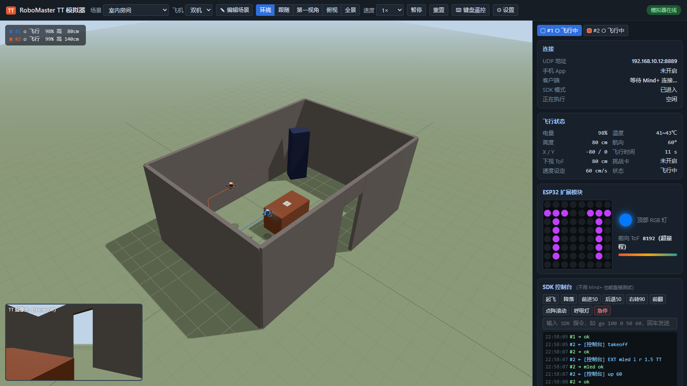
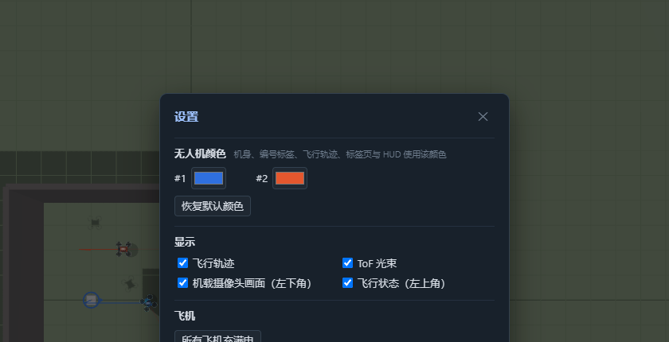
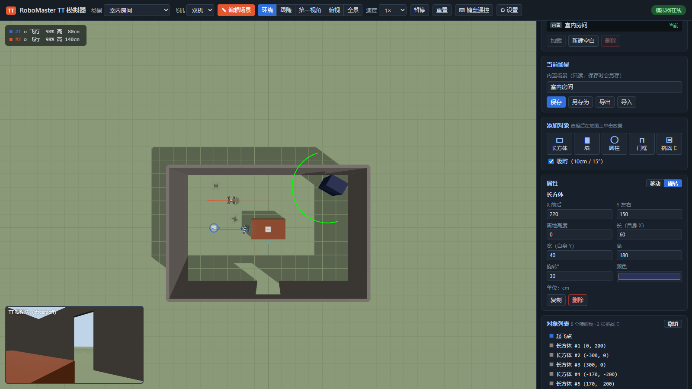
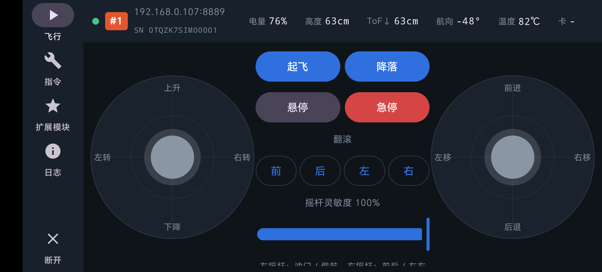

# RoboMaster TT 模拟器（兼容 Mind+ 实时模式）

在电脑上模拟 **RoboMaster TT（Tello EDU + ESP32 扩展模块）**，无需真机、无炸机风险：

- **Mind+ 1.x 实时模式**编写的程序直接连接模拟器运行（首次使用需给 Mind+ 打一个连接补丁，见下文）；
- **3D 场景**中查看飞行、翻滚、8×8 点阵屏、顶部 RGB 灯、ToF 测距、挑战卡识别；
- **场景编辑器**：长方体、墙、圆柱、门框、挑战卡自由摆放，保存到场景库；
- **Android 遥控 App**：双摇杆遥控，**自动发现**局域网中的模拟器（无需输入 IP），同一个 App 也能控制真机；
- **双机模式**：两部手机各控制一架飞机，飞机之间会碰撞。



## 目录

- [快速开始](#快速开始)
- [在模拟器中运行 Mind+ 程序](#在模拟器中运行-mind-程序)
- [3D 界面](#3d-界面)
- [场景库与场景编辑器](#场景库与场景编辑器)
- [Android 遥控 App](#android-遥控-app)
- [双机模式：两部手机各控制一架](#双机模式两部手机各控制一架)
- [支持的指令](#支持的指令)
- [工作原理](#工作原理)
- [命令行参数](#命令行参数)
- [常见问题](#常见问题)
- [局限](#局限)
- [开发](#开发)
- [更新记录](#更新记录)

## 快速开始

环境：Windows 10/11、Python 3.8+（只用标准库，无需 pip 安装任何东西）。

| 启动方式 | 用途 |
|---|---|
| 双击 **`dist\RoboMasterTT\RoboMasterTT-Manager.exe`** | **桌面原生管理中心（推荐）**：带原生 UI，内置绿色 Python 运行时，一键启动管理、网络一键修复与状态监控 |
| 双击 **`start.bat`** | 命令行以单机模式启动：一架飞机，Mind+ 或一部手机控制 |
| 双击 **`start_dual.bat`** | 命令行以双机模式启动：两架飞机，两部手机各控制一架 |

两种方式只决定启动时的模式，运行中随时可以在 3D 界面顶部「**飞机**」下拉框切换 **单机 / 双机**（最多 4 架）。

- 首次运行会弹出 UAC 提权窗口（点「是」），用于添加虚拟 IP 和防火墙规则（`tools\setup_network.ps1`）；
- 随后自动打开浏览器 3D 界面 <http://127.0.0.1:8080/>，右上角显示「模拟器在线」即就绪。

## 桌面原生管理中心 (Desktop Manager)

模拟器现已提供基于 **`ai-win-ui`** 技术打造的 Win32 + Direct2D 原生桌面管理程序，并捆绑了**免安装绿色便携式 Python 3.11 引擎**：

* **开箱即用**：无需手动安装 Python 或配置 PATH，解压即可运行；
* **生命周期守护**：原生程序通过 Win32 管道守护进程启动、监控与优雅停止 Python 仿真后端；
* **网络一键修复**：界面实时检测 `192.168.10.1` 虚拟 IP 与防火墙规则状态，未配置时支持在原生界面中一键管理员提权授权并自动重连；
* **状态总览与 3D 快速呼出**：卡片式呈现 Mind+ 连接状态、仿真场景、无人机电量/高度/姿态，并支持一键打开 3D 视窗；
* **重新编译与打包**：
  ```powershell
  # 一键编译 C++ 管理器并打包发布包至 dist/RoboMasterTT
  powershell -ExecutionPolicy Bypass -File tools\build_desktop_dist.ps1
  ```

> 不用 Mind+ 也能体验：在界面右下角的 **SDK 控制台** 输入指令，或运行
> `python examples/mindplus_like_demo.py`（它发出的 UDP 报文与 Mind+ 程序相同）。

## 在模拟器中运行 Mind+ 程序

Mind+ 实时模式的程序**不需要导入**：程序本来就运行在电脑上的 Mind+ 里，每执行一个积木就向 `192.168.10.1:8889`
发一条指令，而这个地址正是模拟器。

**需要 Mind+ 1.x（已验证 V1.8.1 RC3.0 免安装版）**。Mind+ 2.0（V2.0.7）实时模式的 TT 扩展积木实现均为空函数，
不会发出任何指令，连真机也无法控制。1.x 免安装版解压即用，可与已安装的 2.0 共存。

Mind+ 1.x 只允许连接扫描到的 `RMTT` / `TELLO` 开头的 WiFi，而模拟器没有真实热点，所以首次使用前要给 Mind+ 打一个补丁
（只改 `resources/app.asar` 中 TT 扩展的 3 处代码，自动备份；连接列表多出虚拟热点 `RMTT-SIM`，真实热点照常可连）：

```bash
# 先关闭 Mind+
python tools/patch_mindplus1x.py "F:/hos/tool/MindPlus_Win_V1.8.1_RC3.0"
# 还原：加 --restore
```

1. 启动模拟器（`start.bat`），在 3D 界面顶部「场景」中选好程序需要的场景；
2. 打开 Mind+ 1.x → **实时模式** → 扩展 → **功能模块** → 加载 **RoboMaster TT（单机）** → 返回；
3. 点左侧积木区「RoboMaster TT(单机)」标题右侧的橙色 **!** 图标（顶部菜单「连接设备」只管串口，与 TT 无关），
   在弹出的列表中选 **RMTT-SIM** →「连接」，图标变为绿色对勾即已连接；
4. 打开（「项目 → 打开项目」）或编写程序，点绿旗运行，或直接点击单个积木。3D 界面中飞机执行动作，
   右侧日志显示收到（←）和回复（→）的每条指令。

模拟器重启后 Mind+ 会断开（图标变回 **!**），重新点图标连接即可。

补丁原理、移植到其他 Mind+ 版本、协议细节与问题排查见 **[docs/mindplus-integration.md](docs/mindplus-integration.md)**。

小技巧：

- 先点一下「电池电量」积木，能显示数值就说明 Mind+ 已连上模拟器；
- 「开启 Tello 摄像头」积木会弹出「Tello视频」窗口，显示模拟器的机载摄像头画面（见[视频流](#视频流)）；
- 用 ToF 避障的程序选「障碍物 / ToF 测试」或「圆柱森林」，用挑战卡的程序选「挑战卡」或「穿越门框赛道」；
- 「速度」切到 2× / 4× 可以加快长程序；「重置」让飞机回到起飞点并恢复电量；
- **Mind+ Python 模式**的程序只要是用 UDP 发 Tello 指令的（如 djitellopy、robomaster SDK），同样不用修改即可运行。

上传模式（ArduinoC / MicroPython 烧录到 ESP32）的程序无法在模拟器中运行，见[局限](#局限)。

## 3D 界面

| 区域 | 内容 |
|---|---|
| 顶部工具栏 | 场景切换、飞机数量（单机 / 双机）、✎ 编辑场景、视角（环绕 / 跟随 / 第一视角 / 俯视 / 全景）、0.5×~4× 速度、暂停、重置、⌨ 键盘遥控、⚙ 设置 |
| ⚙ 设置窗口 | 见下图：每架飞机的颜色、显示选项（飞行轨迹、ToF 光束、机载摄像头画面、左上角飞行状态）、所有飞机充满电；设置保存在本浏览器中 |
| 3D 视图 | 鼠标左键旋转、右键平移、滚轮缩放；左上角 HUD 显示飞行状态（多机时每架一行）；左下角为机载摄像头画面 |
| 右侧面板 | 连接信息（含手机 App 应填的地址）、飞行状态、ESP32 扩展模块（点阵 / RGB 灯 / 前向 ToF）、SDK 控制台与收发日志；多机时顶部标签切换飞机，`●` 表示已有客户端连接 |



- **飞机颜色**：不同编号的飞机用颜色区分（默认 #1 蓝、#2 橙、#3 绿、#4 黄，可在 ⚙ 设置中修改），
  机身、头顶编号标签、飞行轨迹、右侧标签页与左上角状态都使用该颜色；手机 App 状态栏的编号徽标使用相同的默认颜色。
- **窄窗口**：窗口较窄时标题与下拉框标签自动精简，1280px 宽仍为单行工具栏；更窄时工具栏换行，3D 区域自动下移、不会被遮挡。
- **飞机模型**：机身、桨叶（起桨 / 飞行时转动）、桨保护罩、扩展模块、8×8 红蓝点阵、顶部 RGB 灯、前向 ToF 光束、机头状态灯（SDK 模式紫色闪烁）。
- **物理**：障碍物会挡住飞行（碰撞时飞机闪红，当前指令返回 `error Collision`），能被 ToF 测到，飞机可以降落在障碍物顶面上；飞机之间也会碰撞。
- **视角**：切换场景时自动取景；编辑场景时推荐「俯视」。
- **键盘遥控**（点亮 ⌨ 键盘遥控按钮后）：W/S 前后、A/D 左右、↑/↓ 升降、Q/E 旋转、T 起飞、L 降落。

## 场景库与场景编辑器



点击顶部 **✎ 编辑场景** 进入编辑模式（右侧切换为编辑面板）：

| 功能 | 操作 |
|---|---|
| 添加对象 | 在「添加对象」中选择 **长方体 / 墙 / 圆柱 / 门框 / 挑战卡**，再到地面上单击放置（按住 Shift 连续放置） |
| 选中 | 在 3D 视图中单击对象，或在「对象列表」中点击；起飞点（蓝色圆环箭头）也可以选中移动 / 旋转 |
| 移动 / 旋转 | 拖动彩色手柄；`W` 移动、`E` 旋转；勾选「吸附」时按 10cm / 15° 对齐 |
| 精确调整 | 属性面板直接输入坐标、尺寸、离地高度、旋转角度、颜色、挑战卡编号（单位 cm） |
| 复制 / 删除 / 撤销 | `Ctrl+D` / `Delete` / `Ctrl+Z`，`Esc` 取消放置或取消选中 |
| 场景库 | 加载（或双击）、新建空白、删除；保存、另存为；导出 / 导入 JSON 文件 |

- 编辑**实时生效**：飞机碰撞、ToF 测距、挑战卡识别立即使用新场景，可以边飞边改。
- 内置场景在 `scenes/builtin/`（只读，修改后保存会提示另存为新名称），你的场景保存在 `scenes/user/`。
- 有未保存的修改时，切换场景会先确认。

**内置场景**

| id | 名称 | 内容 |
|---|---|---|
| `empty` | 空旷场地 | 无障碍物，练习基本飞行 |
| `pads` | 挑战卡 (m1-m8) | 8 张挑战卡 2×4 排列、间距 1m（默认场景） |
| `obstacles` | 障碍物 / ToF 测试 | 正前方 2m 一面墙，四周散布箱体 |
| `course` | 穿越门框赛道 | 三道门框组成 U 形赛道，四角各一张挑战卡 |
| `pillars` | 圆柱森林 | 前方 1~4m 随机分布 12 根柱子，终点 m2 |
| `room` | 室内房间 | 6m×4m 房间，侧墙有门，中央桌子可降落（桌面有 m2） |

**场景文件格式**（坐标单位 cm，X 前 / Y 左 / Z 上，`yaw` 俯视顺时针为正，`z` 为底面离地高度）：

```json
{
  "title": "我的赛道",
  "start": {"x": 0, "y": 0, "yaw": 0},
  "obstacles": [
    {"type": "box", "x": 200, "y": 0, "z": 0, "yaw": 30, "w": 20, "d": 160, "h": 200, "color": "#e4572e"},
    {"type": "cylinder", "x": 100, "y": 80, "z": 0, "r": 20, "h": 150, "color": "#669bbc"},
    {"type": "gate", "x": 300, "y": 0, "z": 0, "yaw": 0, "w": 100, "h": 150, "t": 8, "color": "#f3a712"}
  ],
  "pads": [{"id": 1, "x": 0, "y": 0, "z": 0}]
}
```

| 类型 | 字段 |
|---|---|
| `box` 长方体 / 墙 | `w` 长（沿自身 X）、`d` 宽（沿自身 Y）、`h` 高、`yaw` 旋转 |
| `cylinder` 圆柱 | `r` 半径、`h` 高 |
| `gate` 门框 | `w` 门洞宽、`h` 门洞高、`t` 框粗、`yaw` 旋转（偏航 0° 时沿 X 方向穿过） |
| `pads` 挑战卡 | `id` 编号 1~8，边长 20cm |

## Android 遥控 App



`android/` 是一个原生 Android App（Kotlin + Jetpack Compose，Android 8.0+，横屏），用 Tello SDK 3.0 协议控制无人机。
**同一个 App 既能连模拟器，也能连真实的 RoboMaster TT / Tello EDU。**

| 页面 | 功能 |
|---|---|
| 飞行 | 双虚拟摇杆（美国手：左 = 油门 / 偏航，右 = 前后 / 左右，20Hz 发送 `rc`）、起飞、降落、悬停、急停、四向翻滚、摇杆灵敏度、最近一条回复 |
| 指令 | 按距离 / 角度执行 `up/down/forward/back/left/right/cw/ccw`、设置速度、挑战卡、查询类指令 |
| 扩展模块 | 8×8 点阵绘图（红 / 蓝 / 紫）、滚动文字、静态字符 / 爱心、点阵亮度、顶部 RGB 灯（常亮 / 呼吸 / 闪烁）、前向 ToF（可自动刷新） |
| 日志 | 收发记录 + 任意 SDK 指令输入框 |

**状态栏**（单行，尽量把空间留给摇杆）：连接指示灯（绿 = 正在收到状态推送）、橙色飞机编号、地址与 SN 末 5 位
（执行动作时显示 `▶ 指令`），以及电量、高度、下视 ToF、航向、温度、挑战卡。

### 安装

| 文件 | 说明 |
|---|---|
| `dist/TTController-1.0.0-release.apk` | 发布版，约 1.1MB，推荐 |
| `dist/TTController-debug.apk` | 调试版，约 9.7MB |

两者签名不同，互相替换前需要先卸载已安装的版本。通过 USB 安装：`adb install -r dist/TTController-1.0.0-release.apk`
（荣耀 / 华为等手机需要在手机上确认安装，或在开发者选项中开启「USB 安装」）。

### 连接

**自动发现（推荐）**：手机与电脑连接同一个 WiFi，打开 App，连接页会自动搜索局域网中运行的模拟器，
列出「电脑名 · 飞机编号 · 地址 · 空闲 / 已被某手机连接」，**点一下即可连接**，不用输入 IP。
换一台电脑、或者教室里多台电脑各开一个模拟器都能直接区分；没找到时点「🔍 重新搜索」。

**手动输入**：

| 连接对象 | 手机网络 | 地址 |
|---|---|---|
| 电脑上的模拟器 | 与电脑连接**同一个 WiFi** | 模拟器网页「连接 → 手机 App」显示的地址，如 `192.168.0.107:8889` |
| 模拟器中的第 N 架飞机 | 同上 | 连接页「模拟器飞机」选 **#N**，自动填端口 8889 / 8989 / 9089 / 9189 |
| Android Studio 模拟器 | — | `10.0.2.2:8889` |
| 真实 RoboMaster TT | 连接 `RMTT-xxxxxx` 热点（扩展模块开关拨到 AP 档） | `192.168.10.1` |

App 会记住上次的地址；空闲时每 10 秒发送一次 `rc 0 0 0 0` 保活（真机 15 秒无指令会自动降落）。

## 双机模式：两部手机各控制一架

在 3D 界面顶部「**飞机**」下拉框选择 **双机**（或直接双击 `start_dual.bat` 以双机模式启动），
场景中出现两架飞机，#2 在起飞点左侧 1m：

| 飞机 | 手机 App 地址 | 本机地址（Mind+ / 脚本） | SN |
|---|---|---|---|
| #1 | `电脑IP:8889` | `192.168.10.1:8889` | `0TQZK7SIM00001` |
| #2 | `电脑IP:8989` | `192.168.10.11:8889` | `0TQZK7SIM00002` |

1. 两部手机都连接与电脑相同的 WiFi，安装 App；
2. 连接页的搜索结果中，手机 A 点 **#1**、手机 B 点 **#2**（已被连接的飞机会标出「已被 x.x.x.x 连接」）；
   也可以在「模拟器飞机」里选编号后手动连接；
3. 连接后状态栏显示橙色编号和 SN，确认控制的是哪一架。

两架飞机完全独立：各自的指令、状态推送、点阵屏和 RGB 灯互不影响；它们之间**会发生碰撞**
（双方闪红，正在执行的指令返回 `error Collision`）。

**单双切换**：运行中随时切换，无需重启。切到双机时新增 #2 并开始监听它的地址；切回单机时移除 #2
（若它正在飞行或已有手机连接，会先确认），正在执行的指令返回 `error Interrupted`，连接 #2 的手机将收不到回复。
再次切到双机后，该手机无需重新连接即可继续控制。

更多飞机：下拉框选择 3 架 / 4 架，或 `python -m rmtt_sim --drones 4` 启动，手机端口依次为 8889 / 8989 / 9089 / 9189。
`setup_network.ps1` 默认已为 4 架飞机准备好地址和防火墙规则，更多请运行 `tools\setup_network.ps1 -Drones N`。

**Mind+ 组队模式**：Mind+ 1.x 组队扩展扫描局域网时会跳过本机地址，而模拟器的 `192.168.10.x` 正是本机地址，因此**无法发现模拟器**；单机模式不受影响。

## 支持的指令

**控制**：`command` `takeoff` `land` `emergency` `stop` `motoron` `motoroff` `throwfly`
`up/down/left/right/forward/back x` `cw/ccw x` `flip l/r/f/b` `go x y z speed [mid]`
`curve x1 y1 z1 x2 y2 z2 speed [mid]` `jump x y z speed yaw mid1 mid2` `rc a b c d` `speed x`
`mon` `moff` `mdirection x` `streamon` `streamoff` `wifi` `ap` `multiwifi` `port` `setfps` `setbitrate` `setresolution` `wifisetchannel`

### 视频流

`streamon` 后，模拟器把机载摄像头画面（960×720，H.264 Constrained Baseline，约 20 fps，每秒一个关键帧）按真机格式发到客户端的 UDP **11111** 端口：每帧按 1460 字节分片，最后一片不足 1460 字节表示一帧结束。Mind+「开启 Tello 摄像头」、djitellopy、`ffplay udp://0.0.0.0:11111` 等都可以直接接收。

- 画面由 **3D 界面**渲染并用浏览器 WebCodecs 编码，推流期间**须保持 3D 界面打开**（最小化或被 Mind+ 遮挡也可以，后台时由 Worker 定时器驱动，约 15 fps）；
- WebCodecs 只在安全上下文可用，请用 `http://127.0.0.1:8080` 打开（用局域网 IP 打开时无法推流，画中画标签会提示）；
- 画面中不显示 ToF 光束、飞行轨迹、编号标签等界面辅助图形。

**查询**：`battery?` `speed?` `time?` `wifi?` `sdk?` `sn?` `hardware?`（返回 `RMTT`）`wifiversion?` `ap?` `ssid?`
以及旧版 `height?` `temp?` `attitude?` `baro?` `acceleration?` `tof?`

**扩展模块（EXT，按出厂固件行为模拟）**：

| 指令 | 回复 |
|---|---|
| `EXT tof?` | `tof 650`（mm，超出 1.2m 返回 `tof 8192`） |
| `EXT led r g b` / `EXT led br t r g b` / `EXT led bl t r1 g1 b1 r2 g2 b2` | `led ok` / `led error` |
| `EXT mled g <64位 0/r/b/p>` | `mled ok` / `mled error` |
| `EXT mled s r/b/p <字符或heart>` | 同上 |
| `EXT mled l/r/u/d r/b/p t <字符串>` 滚动文字；`EXT mled l/r/u/d g t <图案>` 滚动图案 | 同上 |
| `EXT mled sg <图案>` 开机图案 / `EXT mled sc` 清除 / `EXT mled sl n` 亮度 | 同上 |
| `EXT version?` | `version=v1.0.0.4` |

**行为细节**（尽量贴近真机）：

| 情况 | 回复 |
|---|---|
| 动作指令 | 动作**完成后**才回复 `ok`（Mind+ 积木是阻塞的） |
| 运动中再发其他动作指令 | `error Not joystick`；重发同一条指令视为 UDP 重传，忽略 |
| 未起飞时移动 / 已在空中时起飞 | `error Motor stop` / `error Already flying` |
| 参数越界（如 `forward 5`） | `error Out of range` |
| 电量低于 50% 时翻滚 | `error Low battery` |
| 撞到障碍物或其他飞机 | `error Collision` |
| 挑战卡不在下视视野内（高度 0.2~3m） | `error No valid marker` |
| 动作被 `stop` / `emergency` 打断 | `error Interrupted` |

## 工作原理

Mind+ 实时模式通过 **Tello SDK 3.0** 文本协议控制飞机：

| 方向 | 地址 | 内容 |
|---|---|---|
| Mind+ → 飞机 | `192.168.10.1:8889` UDP | `command`、`takeoff`、`EXT mled …` 等指令；Mind+ 1.x 的动作指令带防丢包序号 `Re[tag][id] takeoff`，同一 tag 连发 5 遍，只执行一次 |
| 飞机 → Mind+ | 原路返回 | `ok` / `error …` / 查询结果；带序号的指令回复 `Re[tag][id] ok` |
| 飞机 → Mind+ | 电脑 `:8890` UDP，10Hz | 状态字符串 `mid:..;h:..;bat:..;` |
| 飞机 → Mind+ | 电脑 `:11111` UDP（`streamon` 后） | H.264 视频流，按 1460 字节分片 |

`tools\setup_network.ps1` 在 Windows 环回接口上添加虚拟地址：`192.168.10.1`（飞机 #1）、`192.168.10.11~13`（飞机 #2~#4），
以及 `192.168.10.2`（本机客户端的源地址），并添加防火墙入站规则（UDP 8889 / 8989 / 9089 / 9189）。
模拟器监听这些地址，所以 Mind+ 以为自己连上了真飞机，网络层面无需任何修改（Mind+ 1.x 界面上的 WiFi 选择由 `tools/patch_mindplus1x.py` 解决）。虚拟地址只存在于内存中，
重启电脑后自动消失，不影响真实网卡（`start.bat` 会自动检查并重新配置）。

为了让手机连接，模拟器同时在电脑的局域网地址上监听：飞机 #1 用 8889 端口，#2 起依次 8989、9089……
另外监听 `127.0.0.1`，供 Android Studio 模拟器通过 `10.0.2.2` 访问。

### 地址设计

| | 真机 | 模拟器 |
|---|---|---|
| 单机（飞机开热点） | 每台 TT 都是 `192.168.10.1`（每台电脑连的是不同飞机的热点） | #1 固定为 `192.168.10.1`，Mind+ 无需修改 |
| 组队（飞机连路由器） | 路由器给每架飞机分配**不同 IP**，端口都是 8889 | #2 起为 `192.168.10.11`、`.12`…，端口都是 8889 |
| 手机连接 | — | 电脑的局域网 IP + 不同端口（8889 / 8989 / …） |

- 本机多架飞机使用**不同 IP、相同端口**，与真机组队模式一致；Mind+、djitellopy 等程序都把端口写死为 8889，因此不能靠端口区分。
- 手机端使用**同一 IP、不同端口**：要让每架飞机在局域网中各有一个 IP，需要给电脑 WiFi 网卡添加静态地址，
  会关闭网卡的 DHCP、影响正常上网，所以采用端口区分；App 的编号选择与自动发现会自动处理端口。
- 每台电脑的局域网 IP 不同：由**自动发现**解决，手机不需要知道电脑的 IP。

### 自动发现协议

模拟器在 UDP **8899** 端口监听广播（防火墙规则由 `setup_network.ps1` 添加）。App 向 `255.255.255.255:8899`
及各网卡的子网广播地址发送 `RMTT-DISCOVER 1`，模拟器单播回复：

```
RMTT-SIM 1
name=DESKTOP-075FDC7
ips=192.168.0.107,172.17.64.1
drone=1;port=8889;sn=0TQZK7SIM00001;flying=0;client=-
drone=2;port=8989;sn=0TQZK7SIM00002;flying=1;client=192.168.0.106
```

App 使用回复包的来源 IP（不在 `ips` 中时改用 `ips` 的第一个，例如回复经代理软件的虚拟网卡发出时）加上各飞机的端口；
`client` 为最近 15 秒内控制该飞机的客户端（`pc` 表示电脑本机的 Mind+ / 脚本，`-` 表示空闲）。
同一台电脑经多块网卡回复时，按「电脑名 + SN」去重。使用 `--no-lan` 启动时不开启自动发现。

## 命令行参数

```bash
python -m rmtt_sim [--scene 场景id] [--drones N] [--auto-land 15]
                   [--web-host 127.0.0.1] [--web-port 8080] [--no-lan] [--no-browser]
```

| 参数 | 说明 |
|---|---|
| `--scene` | 初始场景 id（`scenes/builtin` 或 `scenes/user` 下的文件名，默认 `pads`） |
| `--drones N` | 启动时的飞机数量（默认 1）；#1 为 `192.168.10.1`，#2 起为 `192.168.10.11`、`.12`……运行中可在网页切换 |
| `--ip A` | 自定义飞机地址池，可重复；第 N 架使用第 N 个地址（指定后 `--drones` 默认用满地址池） |
| `--auto-land S` | 超过 S 秒没收到指令自动降落（真机为 15 秒，默认关闭） |
| `--no-lan` | 不在局域网地址上监听、不开启自动发现（默认开启，供手机 App 连接） |
| `--web-host` / `--web-port` | 3D 界面地址，默认 `127.0.0.1:8080` |
| `--no-browser` | 启动时不自动打开浏览器 |

## 常见问题

- **Mind+ 提示连接失败 / 8889 端口访问失败**：确认模拟器窗口没有报错、网页右上角显示「模拟器在线」；
  确认电脑**没有**同时连接真实飞机的 WiFi（同为 192.168.10.x 网段会冲突）。
- **Mind+ 连接列表里没有 RMTT-SIM**：确认用的是 Mind+ 1.x 且已运行 `tools/patch_mindplus1x.py`（运行前须关闭 Mind+）；
  入口是积木区 TT 标题旁的 **!** 图标，不是顶部「连接设备」菜单。
- **积木点了没反应 / 日志显示 `unknown command: re1001`**：模拟器版本过旧，不认识 Mind+ 1.x 的 `Re` 序号前缀，请更新。
- **Mind+「Tello视频」弹窗没有画面**：确认 3D 界面用 `http://127.0.0.1:8080` 打开且画中画标签显示「推流中」；若曾在没有视频时开过摄像头，Mind+ 自身的 bug 会让 11111 端口一直被占用，需**完全退出 Mind+ 再启动**，连接后只点一次「开启 Tello 摄像头」。详见 [docs/mindplus-integration.md](docs/mindplus-integration.md)。
- **App 搜索不到模拟器**：确认模拟器窗口显示「自动发现 UDP 8899 已开启」；手机与电脑在同一个 WiFi；
  路由器的「访客网络」「AP 隔离」会阻止广播和设备互访；仍不行可以手动输入网页「连接 → 手机 App」显示的地址。
- **换了一台电脑，App 连不上了**：每台电脑的局域网 IP 不同，回到连接页点「🔍 重新搜索」即可找到新电脑。
- **手机 App 连不上模拟器**：
  - 手机和电脑必须在**同一个 WiFi**，路由器的「访客网络」「AP 隔离」会阻止设备互访；
  - 地址以网页「连接 → 手机 App」显示的为准，不要填 `192.168.10.1`（那是电脑内部地址）；
  - 防火墙规则（UDP 8889 / 8989 / 9089 / 9189 / 8899）由 `start.bat` 自动添加，被删除后重新运行 `tools\setup_network.ps1` 即可。
- **App 安装失败 `INSTALL_FAILED_ABORTED: User rejected permissions`**：荣耀 / 华为等手机需要在手机屏幕上确认安装，
  或在开发者选项中开启「USB 安装」后重试。
- **点「起飞」回复 `error Already flying`**：飞机已经在空中，可以直接用摇杆或动作指令。
- **开了代理软件（Clash 等 TUN 模式）**：一般不影响，因为 192.168.10.x 是本机地址；如有问题请把 `192.168.10.0/24` 加入直连规则。
- **重启后连不上**：虚拟 IP 已失效，重新运行 `start.bat` 会自动配置。手动移除地址和防火墙规则：`tools\setup_network.ps1 -Remove`。

## 局限

- 只模拟 **实时模式**。上传模式（把 Arduino / MicroPython 程序烧录到 ESP32）需要模拟 ESP32 芯片本身，不在本项目范围内。
- 视频流依赖浏览器中打开的 3D 界面（WebCodecs 编码），关闭 3D 界面后 `streamon` 仍回复 `ok` 但不出画面；后台时帧率降到约 15 fps。
- 飞行动力学为运动学近似（匀速移动 + 视觉倾角），不模拟风、漂移与定位误差。
- 已用 Mind+ V1.8.1 实测连接与起飞 / 升降 / 前后飞行 / 降落积木，其余积木**尚未逐个验证**；
  若发现某个积木的回复格式不被 Mind+ 接受，请查看网页日志中的收发记录并调整 `rmtt_sim/drone.py`。
- 带 `Re` 序号的查询指令（如「查询电量（活跃）」）按无前缀格式回复数值，真机是否带前缀未经核实。

## 开发

### 目录

```
start.bat                 一键启动（自动配置虚拟 IP 与防火墙）
start_dual.bat            双机模式启动
rmtt_sim/                 模拟器（纯 Python 标准库）
  drone.py                飞行器模型 + SDK 3.0 / EXT 指令解析
  matrix.py               8×8 点阵与 RGB 灯
  world.py                场景几何：长方体 / 圆柱 / 门框、碰撞、ToF 射线检测
  scenes.py               场景库（加载 / 保存 / 删除）
  discovery.py            局域网自动发现（UDP 8899）
  simulator.py            仿真循环、UDP 8889/8890、局域网监听
  web.py                  HTTP API + SSE 推送给 3D 界面
scenes/builtin/           内置场景（JSON）
scenes/user/              你保存的场景
web/                      Three.js 3D 前端（three r160 已内置于 web/vendor，离线可用）
  app.js                  主界面、飞机模型、渲染循环
  editor.js               场景编辑器
  video.js                机载摄像头视频流（WebCodecs H.264 编码，经模拟器转发到 UDP 11111）
  world3d.js              场景对象 → 3D 模型
android/                  Android 遥控 App（Kotlin + Compose）
tools/setup_network.ps1   添加 / 移除虚拟 IP 与防火墙规则
tools/patch_mindplus1x.py 给 Mind+ 1.x 打补丁，无需 WiFi 连接本机模拟器
tools/video_check.py      视频流自检：模拟客户端收 UDP 11111，用 ffmpeg 检查解码与截图
tools/mindplus_wfs_test/  提取 Mind+ 内置 wfs.js，在浏览器中复现 Mind+ 的视频解码
examples/                 模拟 Mind+ 发包的示例程序
tests/                    Python 单元测试
docs/                     文档与截图（mindplus-integration.md：Mind+ 对接、补丁与问题排查）
dist/                     编译好的 APK（不纳入 git）
```

### 测试

```bash
python -m unittest discover tests                 # 模拟器：指令、飞行、碰撞、ToF、挑战卡、场景、单双切换、自动发现、视频分片
python tools/video_check.py --png frame.png       # 视频流端到端自检（需模拟器与 3D 界面已打开）

cd android
set TT_SIM_HOST=192.168.0.107                      # 模拟器地址（模拟器需在运行；建议用单独的测试实例，避免干扰正在使用的飞机）
gradlew.bat testDebugUnitTest                      # 连接测试 + 自动发现测试；模拟器未运行时联调部分自动跳过
```

### 编译 App

需要 JDK 17+ 与 Android SDK 35（在 `android/local.properties` 写 `sdk.dir=D:/Android/Sdk`，或用 Android Studio 直接打开 `android/` 目录）。

```bash
cd android
gradlew.bat assembleDebug          # app/build/outputs/apk/debug/app-debug.apk
gradlew.bat assembleRelease        # app/build/outputs/apk/release/app-release.apk（R8 压缩后约 1.1MB）
```

发布版签名信息从 `android/keystore.properties` 读取（该文件和 `android/keystore/` 已被 `.gitignore` 排除，**不会进入 git**）：

```properties
storeFile=keystore/rmtt-release.jks
storePassword=******
keyAlias=rmtt
keyPassword=******
```

没有该文件时会生成未签名的 `app-release-unsigned.apk`。**请备份 keystore 和密码**：丢失后无法再给已安装的用户发布升级包。

## 更新记录

- **Mind+ 对接文档与调试工具**：新增 [docs/mindplus-integration.md](docs/mindplus-integration.md)（版本选择、连接机制、补丁原理与移植、`Re` 序号、视频链路、问题排查、扩展指南、代码位置速查）；新增 `tools/video_check.py`、`tools/mindplus_wfs_test/`。
- **机载摄像头视频流**：`streamon` 后输出真机格式的 H.264 视频流到客户端 UDP 11111，Mind+「开启 Tello 摄像头」可显示模拟器画面；3D 界面最小化或被遮挡时继续推流；机载画面（画中画 / 视频流）不再显示 ToF 光束等辅助图形。
- **Mind+ 1.x 实测打通**：支持 Mind+ 实时模式的 `Re[tag][id] 指令` 防丢包序号（同一 tag 连发 5 遍只执行一次，
  回复 `Re[tag][id] ok`）；新增 `tools/patch_mindplus1x.py`，让 Mind+ 1.x 无需真实 WiFi 即可连接本机模拟器；
  文档改正连接步骤，说明 Mind+ 2.0 实时模式 TT 扩展不可用。
- **自动发现**：App 连接页自动搜索局域网中的模拟器并显示空闲 / 占用状态，点击即连接，换电脑无需输入 IP；
  文档补充地址设计说明与发现协议。
- **飞机颜色与设置窗口**：不同编号的飞机用颜色区分并可自定义；新增 ⚙ 设置窗口（颜色、显示选项、充电），
  工具栏精简，1280px 宽窗口也能单行显示。
- **单双切换**：3D 界面顶部「飞机」下拉框在运行中切换单机 / 双机（最多 4 架），无需重启；
  App 状态栏改为单行、飞行页中间控制区紧凑排列，横屏无需滚动，摇杆区域更大。
- **App 界面优化**：状态栏读数单行均分、不再换行挤压；地址与 SN 两行显示；飞行页显示最近一条回复。
- **场景库与双机模式**：场景改为 JSON 场景库，新增场景编辑器（长方体 / 墙 / 圆柱 / 门框 / 挑战卡 / 起飞点）、
  「圆柱森林」「室内房间」两个内置场景、俯视 / 全景视角；双机模式与飞机间碰撞；App 可选择模拟器飞机编号并显示 SN；
  修复飞机无法降落在障碍物顶面的问题。
- **首个版本**：兼容 Mind+ 实时模式的 Tello SDK 3.0 模拟器、Three.js 3D 界面、Android 遥控 App（debug / release）。

参考：[Tello SDK 3.0 使用说明](https://dl.djicdn.com/downloads/RoboMaster%20TT/Tello_SDK_3.0_User_Guide_cn.pdf) ·
[Mind+ RoboMaster TT 教程](https://mindplus.dfrobot.com.cn/RMTT) · 点阵字库 [font8x8](https://github.com/dhepper/font8x8)（Public Domain）
